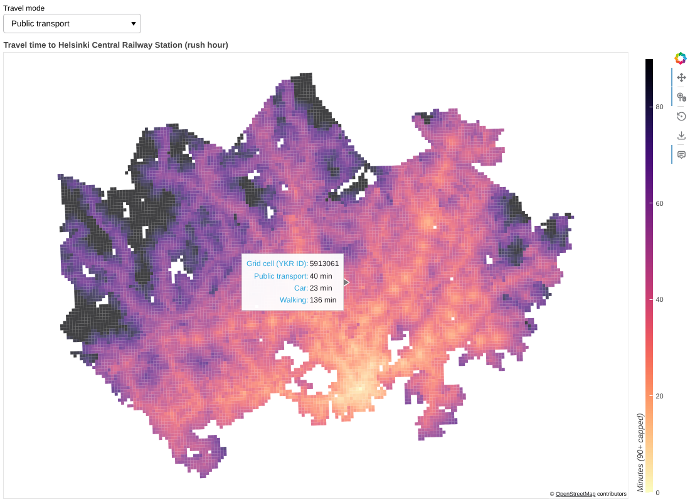

# Interactive Travel-Time Map (Bokeh)

An interactive web map of travel times to Helsinki Central Railway Station. Hover any 250 m grid cell to compare its rush-hour travel time by public transport, car, and on foot, and use the menu to recolor the whole map by mode.

**Live demo:** https://joechangportfolio.onrender.com/demos/helsinki-travel-times.html



## Features

- About 13,000 grid cells drawn as Bokeh patches over an OpenStreetMap basemap
- Hover tooltips with all three travel times for the cell under the cursor
- A travel-mode dropdown that recolors the map in the browser with a small `CustomJS` callback, so no Python server is needed
- Output is a single standalone HTML file (`docs/index.html`) that can be hosted anywhere, including GitHub Pages

## Skills demonstrated

- Reprojecting with GeoPandas (EPSG:3067 to Web Mercator) to align data with web tiles
- Converting a GeoDataFrame to GeoJSON for a browser-based renderer
- Bokeh color mapping, tile providers, hover tools, and JavaScript callbacks
- Keeping the output small: rounding coordinates to whole meters and loading BokehJS from the CDN

## Run it

```bash
pip install -r requirements.txt
python interactive_map.py                 # writes docs/index.html
python interactive_map.py --out map.html  # custom output path
```

Open the HTML file in a browser. To publish it with GitHub Pages, go to **Settings → Pages** and serve from the `master` branch, `/docs` folder.

## Data

Helsinki Region Travel Time Matrix 2018 (Digital Geography Lab, University of Helsinki), from the [AutoGIS course](https://autogis-site.readthedocs.io/) materials (MIT License). Basemap © OpenStreetMap contributors.
